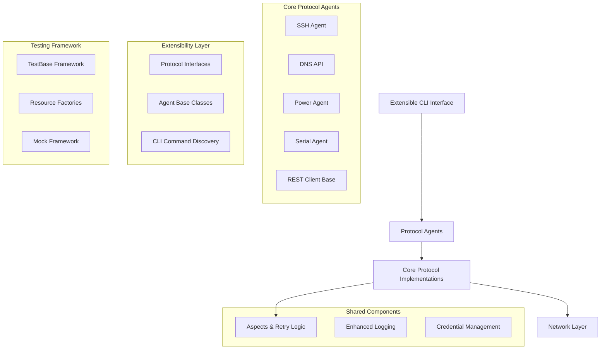

# Design Document

## Overview

The codecraftai-interop package implements a layered architecture that provides consistent interoperability protocols for automation
testing. The design follows a modular approach where core protocols (SSH, DNS, Power, Serial, REST) are implemented as separate
components with shared aspects-based configuration. The system emphasizes debuggability over performance and readability over
conciseness, making it ideal for test automation scenarios.

The architecture has been designed for extensibility, allowing additional protocols to be developed as separate modules while
maintaining compatibility with the core interop framework through well-defined interfaces and base classes.

### Core Design Philosophy

This is an **interop library designed to be consumed by test frameworks** (like testbase and testplus) and deliberately favors
**stability and exactness over performance and resilience**. The architecture is built around two fundamental principles:

#### 1. Application Layer Control
The application layer code (test code) maintains complete control over code flow and error handling, not the framework code.
Framework APIs strictly follow exception handling rules from the coding standards. When common error handling implementations
are needed to reduce verbosity, an explicit contract exists between application and framework layers through the **Aspects**
system. The aspects object conveys contractual behavior parameters, ensuring all flow control and error handling decisions are
explicitly delegated from application to framework via API contract.

#### 2. Measured Reliability
Because this code interoperates with distributed systems for testing purposes, the application layer must control the persistence
of individual calls to remote hosts or APIs. Test code identifies constraints and uses them to determine framework persistence
behavior. For example:

- Testing REST API error responses: Framework should only retry connections, then accept and return any API response
- Testing successful operations: Framework should wait for both successful connection and successful response

The **Action Patterns** (SINGLE_CALL, DO_UNTIL_SUCCESS, DO_WHILE_SUCCESS, etc.) provide this measured reliability control,
allowing test code to specify exactly how persistent the protocol code should be under different circumstances.

## Architecture

### High-Level Architecture



### Layered Architecture

1. **CLI Layer**: Extensible command-line interface using Click framework with dynamic discovery
2. **Agent Layer**: High-level protocol agents (SSH, DNS, Power, Serial, REST)
3. **Protocol Layer**: Low-level protocol implementations with consistent interfaces
4. **Aspects Layer**: Cross-cutting concerns (retry, timeout, logging)
5. **Network Layer**: Socket and HTTP communication primitives

### Core Protocol Suite

The current core interop package includes these essential protocols:

#### SSH Protocol
- **Full SSH client implementation** with session management
- **File transfer capabilities** via SFTP and primitive methods
- **Jump host support** for complex network topologies
- **Interactive and non-interactive** command execution modes

#### DNS/mDNS Protocol
- **Comprehensive DNS implementation** with multiple record types
- **mDNS service discovery** and presence detection
- **Multicast DNS server** for network service advertising
- **DNS message parsing and construction** with validation

#### Power Management Protocol
- **DLI Power Strip support** via REST API
- **Outlet-level control** for remote power cycling
- **Status monitoring** and power state management
- **Extensible base classes** for additional power strip manufacturers

#### Serial Communication Protocol
- **TCP-based serial communication** for network-attached serial devices
- **Session management** for persistent connections
- **Binary data handling** with configurable timeouts
- **Agent and session patterns** consistent with SSH implementation

#### REST Client Framework
- **Base REST client implementation** with aspects integration
- **Consistent retry and timeout handling** across REST operations
- **Credential management integration** for authenticated APIs
- **Foundation for protocol-specific REST implementations**

## Components and Interfaces

### Aspects System

The aspects system provides consistent configuration across all protocols:

```python
class Aspects:
    - action_pattern: ActionPattern
    - completion_timeout: float
    - completion_interval: float
    - connection_timeout: float
    - connection_interval: float
    - inactivity_timeout: float
    - logging_pattern: LoggingPattern
    - allowed_error_codes: List[int]
```

**Key Design Decisions:**
- Single configuration object for all retry/timeout behavior
- Extensible pattern system (SINGLE_CALL, DO_UNTIL_SUCCESS, etc.) for measured reliability
- Consistent logging patterns across protocols
- Explicit contract mechanism between application and framework layers
- Application layer maintains complete control over persistence and error handling behavior

### SSH Agent

Provides secure shell connectivity with session management:

```python
class SshAgent(SshBase):
    - host: str
    - primary_credential: SshCredential
    - port: int
    - jump: Optional[SshJumpParams]
    
    Methods:
    - run_cmd(command, aspects) -> (status, stdout, stderr)
    - open_session(aspects) -> SshSession
    - transfer_file(local_path, remote_path, aspects)
```

**Key Design Decisions:**
- Session-based connection management
- Jump host support for complex network topologies
- Credential management integration
- PTY parameter support for interactive commands

### REST Client Base System

Provides foundation for REST-based protocol implementations:

```python
class RestClientBase:
    - host: str
    - credentials: Credential
    - aspects: AspectsRest
    
    Methods:
    - get(endpoint, aspects) -> Response
    - post(endpoint, data, aspects) -> Response
    - put(endpoint, data, aspects) -> Response
    - delete(endpoint, aspects) -> Response
```

**Key Design Decisions:**
- Aspects-based configuration for REST operations
- Consistent retry and timeout handling
- Credential management integration
- Base class for protocol-specific REST clients

### DNS API System

Provides DNS query and mDNS service discovery:

```python
class DnsAPI:
    Methods:
    - dns_query_name(name, rtype, rclass) -> str
    - dns_query_services(service_types) -> None
    
class DnsServer:
    - start() -> None
    - wait() -> None
```

**Key Design Decisions:**
- Separate query construction and execution
- mDNS service discovery support
- Structured DNS record parsing
- Service type filtering capabilities

### Power Management

REST API-based power control for DLI power strips:

```python
class DliPowerAgent(PowerAgentBase):
    - host: str
    - credentials: Credential
    
    Methods:
    - power_on_outlet(outlet_id, aspects)
    - power_off_outlet(outlet_id, aspects)
    - get_outlet_status(outlet_id, aspects)
```

**Key Design Decisions:**
- REST client base for HTTP communication
- Outlet-specific control granularity
- Status monitoring capabilities
- Credential-based authentication

### Serial Communication

TCP-based serial communication agent:

```python
class TcpSerialAgent(SerialAgentBase):
    - host: str
    - port: int
    
    Methods:
    - connect(aspects) -> TcpSerialSession
    - send_data(data, aspects)
    - receive_data(aspects) -> bytes
```

**Key Design Decisions:**
- TCP socket-based serial communication
- Session management for persistent connections
- Configurable timeout and retry behavior
- Binary data handling support

## Data Models

### DNS Models

```python
class DnsQuestion:
    - name: str
    - rtype: DnsRecordType
    - rclass: DnsRecordClass
    
    Methods:
    - as_dns_string() -> str
```

### Credential Models

```python
class SshCredential:
    - username: str
    - password: Optional[str]
    - private_key: Optional[str]
    - passphrase: Optional[str]
```

## Error Handling

### Exception Hierarchy

- **Base Exceptions**: Protocol-specific base exceptions
- **Connection Exceptions**: Network connectivity issues
- **Timeout Exceptions**: Operation timeout scenarios
- **Authentication Exceptions**: Credential-related failures
- **Protocol Exceptions**: Protocol-specific errors

### Retry Strategies (Measured Reliability)

The framework provides action patterns that allow test code to specify exactly how persistent operations
should be:

1. **SINGLE_CALL**: Execute once, return result - for testing error conditions where retries would mask the
   behavior being tested
2. **DO_UNTIL_SUCCESS**: Retry until operation succeeds - for testing successful operations where transient
   failures should be overcome
3. **DO_WHILE_SUCCESS**: Continue while operations succeed - for testing sustained operations
4. **DO_UNTIL_CONNECTION_FAILURE**: Retry only on connection issues, accept all response codes - for testing
   API responses while handling network instability

Each pattern serves specific testing scenarios where the application layer needs precise control over framework
persistence behavior.

### Error Handling Philosophy

**There is no error recovery in the interop library.** When an error condition occurs that exceeds the specified
constraints in the aspects configuration, the error is immediately raised and passed to the consuming application
(such as a test framework) to handle appropriately.

- **Immediate failure on constraint violation**: Library raises exceptions immediately when operations exceed
  specified timeouts, retry limits, or encounter disallowed error conditions
- **Loud and immediate error reporting**: Errors are reported with full context at the moment they occur to capture
  accurate diagnostic information
- **Configurable constraints**: Consuming application specifies exactly what constitutes a failure through aspects
  (allowed error codes, timeout limits, retry patterns)
- **No silent failures**: Library never suppresses or recovers from errors - all failures are explicitly surfaced
  to the consuming application
- **Context preservation**: When errors occur, full operational context is preserved and reported to aid in debugging
  the specific failure condition

## Testing Strategy

### Test Organization

```
source/testroots/ccai/tests/singlehost/interop/
├── protocols/
│   ├── dns/
│   ├── ssh/
│   ├── upnp/
│   ├── power/
│   └── serial/
└── shared/
    └── factories/
```

### Testing Patterns

1. **Unit Tests**: Individual component testing with mocks
2. **Integration Tests**: Protocol-level testing with real connections
3. **Resource Factories**: Shared test fixtures and resources
4. **Mock Framework**: Comprehensive mocking for external dependencies

### Test Execution

- TestBase framework for test orchestration
- JSOS output format for machine processing
- Single-host test execution model
- Isolated test environments with virtual environments

### Quality Assurance

- Sphinx-style documentation requirements
- Type hints for all public APIs
- Comprehensive error handling coverage
- Performance monitoring for timeout scenarios

## CLI Interface Design

### Extensible Command Discovery

The CLI system uses a dynamic discovery mechanism that automatically loads command groups from namespace packages:

```python
def discover_command_groups(root: click.Group):
    """
        Discovers modules under 'ccai.interop.cli.cmdtree' namespace
        and registers their command groups with the root CLI.
    """
```

### Command Structure

```
am-interop
├── [dynamically discovered protocol commands]
└── [extensible via cmdtree namespace packages]
```

**Key Design Decisions:**
- Namespace package-based command discovery
- Protocol-specific CLI modules can be added independently
- Automatic registration of command groups via `register_groups()` function
- Supports distributed development of protocol extensions

### Configuration Management

- Environment variable support
- Configuration file integration
- Runtime variable management
- Logging level control

## Extensibility Design

### Protocol Interface System

The architecture provides well-defined interfaces for extending the system:

```python
class ISystemContext(Protocol):
    """Common interface for system command execution contexts"""
    
class INetworkClient(Protocol):
    """Common interface for network-based clients"""
```

### Agent Base Classes

Extensible base classes provide foundation for new protocol implementations:

```python
class SystemAgentBase(ISystemContext):
    """Base class for agents that execute system commands"""
    
class SerialAgentBase(ISystemContext):
    """Base class for serial communication agents"""
    
class PowerAgentBase:
    """Base class for power management agents"""
```

### CLI Extension Mechanism

- **Namespace Package Discovery**: CLI commands are discovered via `ccai.interop.cli.cmdtree` namespace
- **Dynamic Registration**: Protocol modules register commands via `register_groups()` function
- **Modular Development**: Each protocol can provide its own CLI commands independently

### Protocol Extensions

The architecture supports adding new protocols by:

1. **Implementing Protocol Interfaces**: Use `ISystemContext` or `INetworkClient` as appropriate
2. **Extending Base Classes**: Inherit from `SystemAgentBase`, `SerialAgentBase`, or `PowerAgentBase`
3. **Integrating Aspects System**: Use consistent retry, timeout, and logging patterns
4. **Adding CLI Commands**: Create cmdtree namespace package with `register_groups()` function
5. **Following Naming Conventions**: Maintain consistency with existing protocol structure

### Manufacturer Extensions

- **Manufacturer Directory**: `source/packages/ccai/interop/manufacturers/` for vendor-specific implementations
- **Factory Pattern Support**: Extensible factory registration for device-specific behaviors
- **Custom Protocol Implementations**: Manufacturer-specific protocol variations

### Modular Architecture Benefits

- **Independent Development**: Protocols can be developed and maintained separately
- **Clean Separation**: Core interop framework remains stable while protocols evolve
- **Consistent Integration**: All protocols share common aspects, interfaces, and patterns
- **Distributed Packaging**: Protocols can be packaged and distributed independently