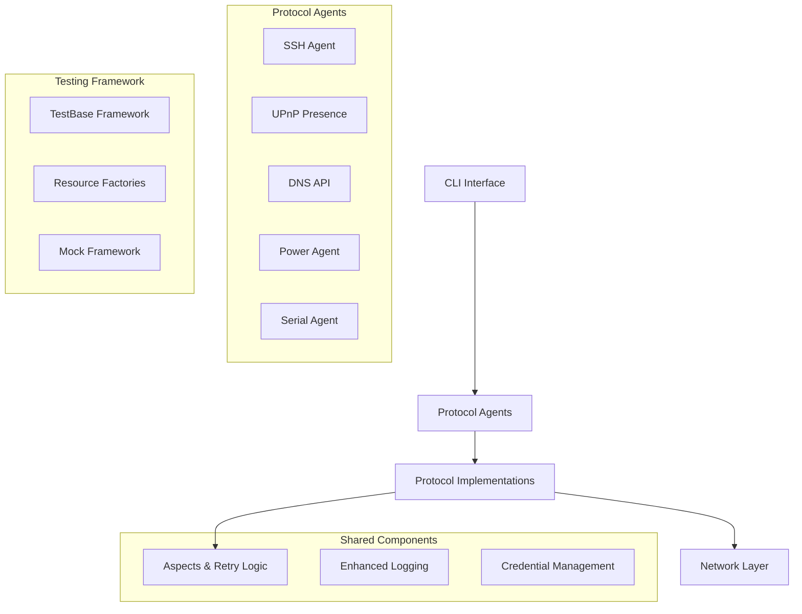

# Design Document

## Overview

The automojo-interop package implements a layered architecture that provides consistent interoperability protocols for automation testing. The design follows a modular approach where each protocol (SSH, UPnP, DNS, Power, Serial) is implemented as a separate component with shared aspects-based configuration. The system emphasizes debuggability over performance and readability over conciseness, making it ideal for test automation scenarios.

### Core Design Philosophy

This is an **interop library designed to be consumed by test frameworks** (like testbase and testplus) and deliberately favors **stability and exactness over performance and resilience**. The architecture is built around two fundamental principles:

#### 1. Application Layer Control
The application layer code (test code) maintains complete control over code flow and error handling, not the framework code. Framework APIs strictly follow exception handling rules from the coding standards. When common error handling implementations are needed to reduce verbosity, an explicit contract exists between application and framework layers through the **Aspects** system. The aspects object conveys contractual behavior parameters, ensuring all flow control and error handling decisions are explicitly delegated from application to framework via API contract.

#### 2. Measured Reliability
Because this code interoperates with distributed systems for testing purposes, the application layer must control the persistence of individual calls to remote hosts or APIs. Test code identifies constraints and uses them to determine framework persistence behavior. For example:
- Testing REST API error responses: Framework should only retry connections, then accept and return any API response
- Testing successful operations: Framework should wait for both successful connection and successful response

The **Action Patterns** (SINGLE_CALL, DO_UNTIL_SUCCESS, DO_WHILE_SUCCESS, etc.) provide this measured reliability control, allowing test code to specify exactly how persistent the protocol code should be under different circumstances.

## Architecture

### High-Level Architecture



### Layered Architecture

1. **CLI Layer**: Command-line interface using Click framework
2. **Agent Layer**: High-level protocol agents (SSH, UPnP, etc.)
3. **Protocol Layer**: Low-level protocol implementations
4. **Aspects Layer**: Cross-cutting concerns (retry, timeout, logging)
5. **Network Layer**: Socket and HTTP communication primitives

## Components and Interfaces

### Aspects System

The aspects system provides consistent configuration across all protocols:

```python
class Aspects:
    - action_pattern: ActionPattern
    - completion_timeout: float
    - completion_interval: float
    - connection_timeout: float
    - connection_interval: float
    - inactivity_timeout: float
    - logging_pattern: LoggingPattern
    - allowed_error_codes: List[int]
```

**Key Design Decisions:**
- Single configuration object for all retry/timeout behavior
- Extensible pattern system (SINGLE_CALL, DO_UNTIL_SUCCESS, etc.) for measured reliability
- Consistent logging patterns across protocols
- Explicit contract mechanism between application and framework layers
- Application layer maintains complete control over persistence and error handling behavior

### SSH Agent

Provides secure shell connectivity with session management:

```python
class SshAgent(SshBase):
    - host: str
    - primary_credential: SshCredential
    - port: int
    - jump: Optional[SshJumpParams]
    
    Methods:
    - run_cmd(command, aspects) -> (status, stdout, stderr)
    - open_session(aspects) -> SshSession
    - transfer_file(local_path, remote_path, aspects)
```

**Key Design Decisions:**
- Session-based connection management
- Jump host support for complex network topologies
- Credential management integration
- PTY parameter support for interactive commands

### UPnP Presence System

Implements UPnP device discovery and management:

```python
class UpnpPresence:
    - device_query_manager: DeviceQueryManager
    - search_windows: Dict[str, UpnpSearchWindow]
    
    Methods:
    - discover_devices(window_length) -> UpnpSearchWindow
    - get_device_details(usn) -> UpnpDeviceDetail
    - start_monitoring()
    - stop_monitoring()
```

**Key Design Decisions:**
- Multicast listener for SSDP discovery
- Device metadata caching and management
- Manufacturer-specific extension support
- Code generation for device proxy classes

### DNS API System

Provides DNS query and mDNS service discovery:

```python
class DnsAPI:
    Methods:
    - dns_query_name(name, rtype, rclass) -> str
    - dns_query_services(service_types) -> None
    
class DnsServer:
    - start() -> None
    - wait() -> None
```

**Key Design Decisions:**
- Separate query construction and execution
- mDNS service discovery support
- Structured DNS record parsing
- Service type filtering capabilities

### Power Management

REST API-based power control for DLI power strips:

```python
class DliPowerAgent(PowerAgentBase):
    - host: str
    - credentials: Credential
    
    Methods:
    - power_on_outlet(outlet_id, aspects)
    - power_off_outlet(outlet_id, aspects)
    - get_outlet_status(outlet_id, aspects)
```

**Key Design Decisions:**
- REST client base for HTTP communication
- Outlet-specific control granularity
- Status monitoring capabilities
- Credential-based authentication

### Serial Communication

TCP-based serial communication agent:

```python
class TcpSerialAgent(SerialAgentBase):
    - host: str
    - port: int
    
    Methods:
    - connect(aspects) -> TcpSerialSession
    - send_data(data, aspects)
    - receive_data(aspects) -> bytes
```

**Key Design Decisions:**
- TCP socket-based serial communication
- Session management for persistent connections
- Configurable timeout and retry behavior
- Binary data handling support

## Data Models

### Device Models

```python
class UpnpDeviceDetail:
    - usn: str
    - device_type: str
    - friendly_name: str
    - manufacturer: str
    - model_name: str
    - services: List[ServiceDesc]
    - embedded_devices: List[EmbeddedDeviceDesc]
```

### DNS Models

```python
class DnsQuestion:
    - name: str
    - rtype: DnsRecordType
    - rclass: DnsRecordClass
    
    Methods:
    - as_dns_string() -> str
```

### Credential Models

```python
class SshCredential:
    - username: str
    - password: Optional[str]
    - private_key: Optional[str]
    - passphrase: Optional[str]
```

## Error Handling

### Exception Hierarchy

- **Base Exceptions**: Protocol-specific base exceptions
- **Connection Exceptions**: Network connectivity issues
- **Timeout Exceptions**: Operation timeout scenarios
- **Authentication Exceptions**: Credential-related failures
- **Protocol Exceptions**: Protocol-specific errors

### Retry Strategies (Measured Reliability)

The framework provides action patterns that allow test code to specify exactly how persistent operations should be:

1. **SINGLE_CALL**: Execute once, return result - for testing error conditions where retries would mask the behavior being tested
2. **DO_UNTIL_SUCCESS**: Retry until operation succeeds - for testing successful operations where transient failures should be overcome
3. **DO_WHILE_SUCCESS**: Continue while operations succeed - for testing sustained operations
4. **DO_UNTIL_CONNECTION_FAILURE**: Retry only on connection issues, accept all response codes - for testing API responses while handling network instability

Each pattern serves specific testing scenarios where the application layer needs precise control over framework persistence behavior.

### Error Handling Philosophy

**There is no error recovery in the interop library.** When an error condition occurs that exceeds the specified constraints in the aspects configuration, the error is immediately raised and passed to the consuming application (such as a test framework) to handle appropriately.

- **Immediate failure on constraint violation**: Library raises exceptions immediately when operations exceed specified timeouts, retry limits, or encounter disallowed error conditions
- **Loud and immediate error reporting**: Errors are reported with full context at the moment they occur to capture accurate diagnostic information
- **Configurable constraints**: Consuming application specifies exactly what constitutes a failure through aspects (allowed error codes, timeout limits, retry patterns)
- **No silent failures**: Library never suppresses or recovers from errors - all failures are explicitly surfaced to the consuming application
- **Context preservation**: When errors occur, full operational context is preserved and reported to aid in debugging the specific failure condition

## Testing Strategy

### Test Organization

```
source/testroots/automojo/tests/singlehost/interop/
├── protocols/
│   ├── dns/
│   ├── ssh/
│   ├── upnp/
│   ├── power/
│   └── serial/
└── shared/
    └── factories/
```

### Testing Patterns

1. **Unit Tests**: Individual component testing with mocks
2. **Integration Tests**: Protocol-level testing with real connections
3. **Resource Factories**: Shared test fixtures and resources
4. **Mock Framework**: Comprehensive mocking for external dependencies

### Test Execution

- TestBase framework for test orchestration
- JSOS output format for machine processing
- Single-host test execution model
- Isolated test environments with virtual environments

### Quality Assurance

- Sphinx-style documentation requirements
- Type hints for all public APIs
- Comprehensive error handling coverage
- Performance monitoring for timeout scenarios

## CLI Interface Design

### Command Structure

```
am-interop
├── upnp
│   ├── scan [--window-length] [--factory-module]
│   └── generate
└── [future protocols]
```

### Configuration Management

- Environment variable support
- Configuration file integration
- Runtime variable management
- Logging level control

## Extensibility Design

### Manufacturer Extensions

- Plugin-based manufacturer support
- Device-specific mapping capabilities
- Custom service implementations
- Factory registration system

### Protocol Extensions

- Base classes for new protocol implementations
- Consistent aspects integration
- Shared networking primitives
- Common error handling patterns

### Future Protocol Support

The architecture supports adding new protocols by:

1. Implementing protocol-specific agent classes
2. Integrating with the aspects system
3. Adding CLI command trees
4. Creating corresponding test suites
5. Following established naming conventions